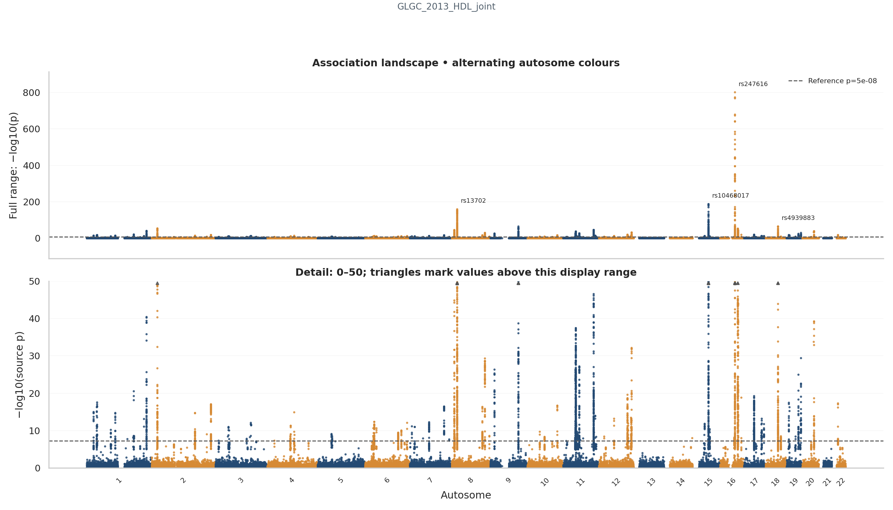
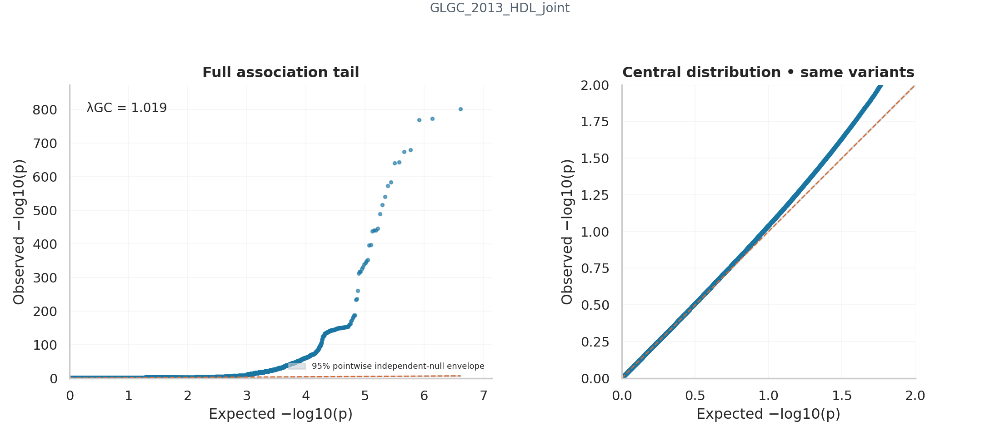
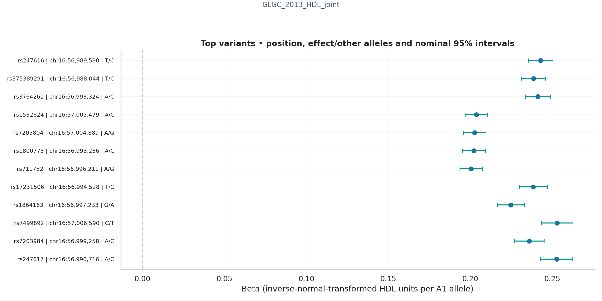
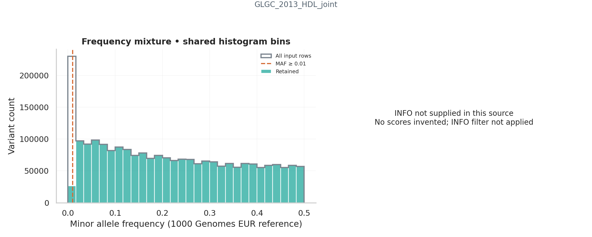
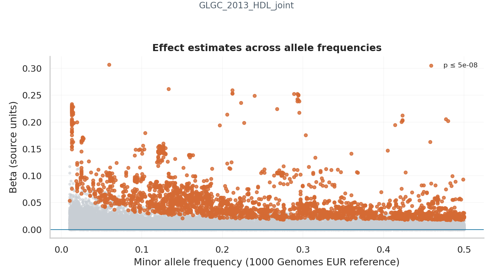
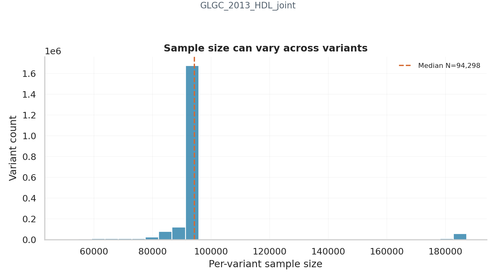
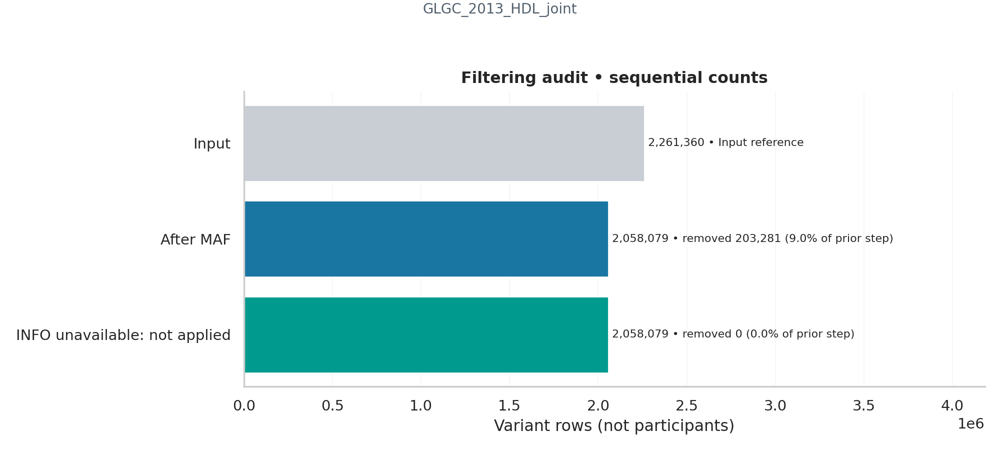
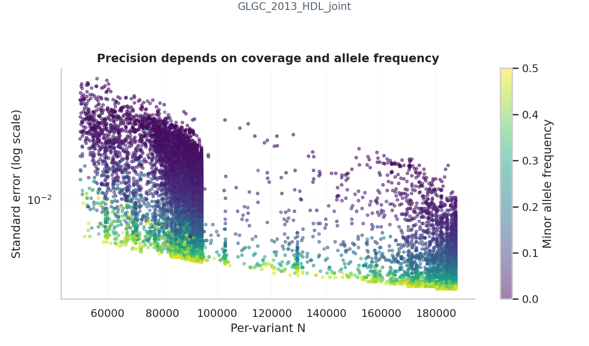
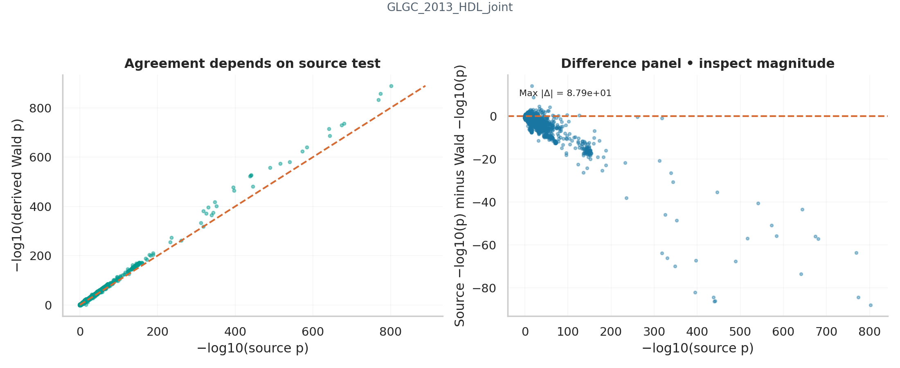
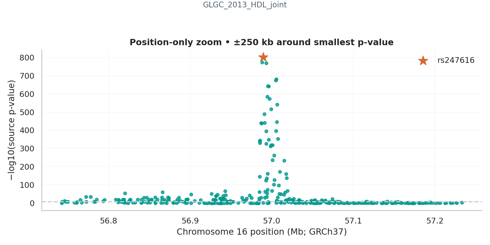

# Preview the GLGC results

The figures below come from the verified HDL release and the documented preparation/filtering steps. Read them alongside `results/glgc-hdl/tables/`. Ten PNG figure families answer different questions.

## Association landscape

{width=100%}

Autosomes alternate dark blue and orange. The strongest retained source association is **rs247616**, chromosome 16 at **56,989,590** on GRCh37, with **p=1.15e-802**. A full-range panel preserves that extreme value; the detail panel makes weaker signals visible. Triangles mark values above the detail panel's display limit. Neither panel alters source values.

The plot contains all retained rows with p≤1e-5 plus 50,000 reproducibly sampled background rows. Calculations and the count of **3,285 variants at p≤5e-8** use all 2,058,079 retained rows. Do not count visible dots or interpret 3,285 as independent loci.

## Distribution of p-values

{width=100%}

The upper tail departs strongly from the simple reference. Lambda GC is **1.018789** for the retained file. These are post-release diagnostics: the source already used genomic control, and the joint design includes a custom array. A lambda near one does not prove absence of confounding or complete calibration.

Plot ranks are drawn from the full sorted retained file, and expected values use its full count. The shaded band assumes independent uniform null p-values; it is pointwise, not simultaneous or LD-adjusted.

## Selected effect estimates

{width=100%}

The top twelve rows cluster on chromosome 16. This demonstrates why twelve small-p variants need not be twelve distinct findings. A1 is the increasing allele in this release, so the displayed betas are positive. Their units are the transformed HDL trait scale, **not mg/dL**. Intervals are derived as beta ±1.96×SE; they do not recreate the corrected meta-analysis test or adjust for selecting top rows.

## Frequency and unavailable quality information

{width=100%}

Input and retained histograms use identical bins. The frequency filter uses **1000 Genomes EUR reference MAF**. The right panel intentionally reports unavailable INFO instead of inventing a distribution. Absence of this field does not establish either good or poor imputation quality.

## Effect and frequency

{width=100%}

Orange points meet the configured source p-value reference. Most smaller effects sit near zero, while some larger effects are visible. The plot is not an estimate of genetic architecture: effect coding, precision, source ascertainment and the display sample matter.

## Per-variant support

{width=100%}

N varies across variants as contributing data differ. The source includes some decimal N values; they are preserved as reported. Do not round them into invented participant counts or assume they are effective N without source confirmation.

## Filtering audit

{width=100%}

**203,281 prepared rows (8.99%)** fail the reference MAF threshold. The third stage removes none because INFO is unavailable. The separate source-preparation audit accounts for the earlier 186,081 rows with unavailable reference frequency.

## Precision with frequency context

{width=100%}

SE varies at similar N. Reference frequency provides useful context, but it is not the study frequency and this scatter does not fit a precision model. Source meta-analysis methods and contributing cohorts also affect interpretation.

## Source p-values versus a derived Wald calculation

{width=100%}

These values do **not** agree as closely as in synthetic practice. That is expected: the paper describes a weighted Stouffer meta-analysis and genomic control, whereas the check uses the reported beta divided by its SE [@Willer2013]. Do not overwrite source p-values with the derived values to force agreement.

For rs3764261, source −log10(p) is **768.856985**, while derived Wald −log10(p) is **832.466119**. Both can be calculated correctly while answering different statistical questions.

## Regional position view

{width=100%}

This view contains **430 retained variants**. It locates a strong association cluster but supplies no LD colours, causal probabilities or gene assignments. Build-matched annotation and suitable LD data would be separate follow-up inputs.

**Your task:** choose three figures that would support a short report. For each, name a checked number, its table and a limitation.

[Next: Meet the data](02-meet-the-data.qmd)
