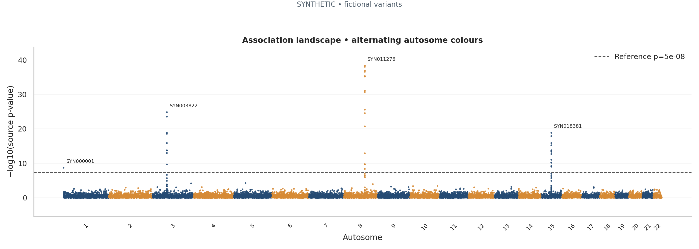
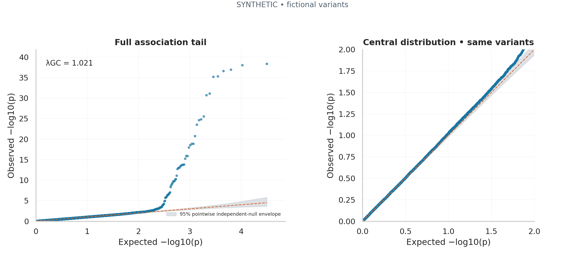
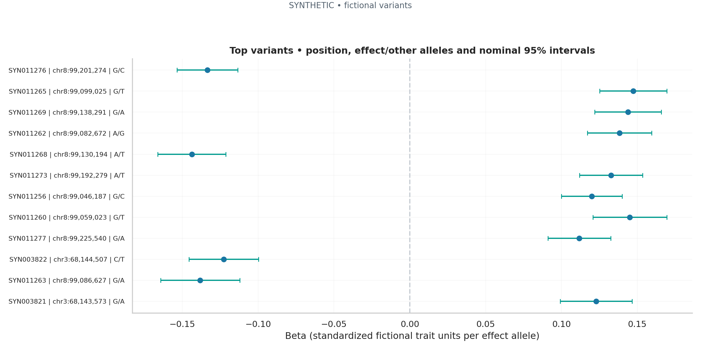
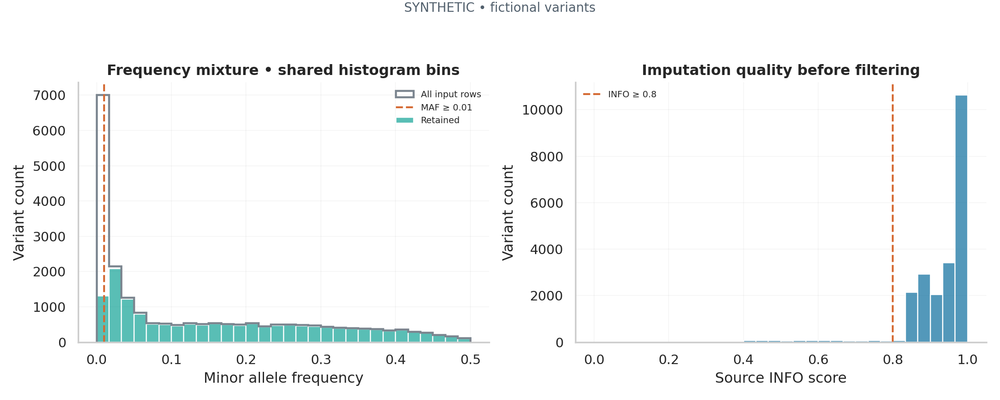
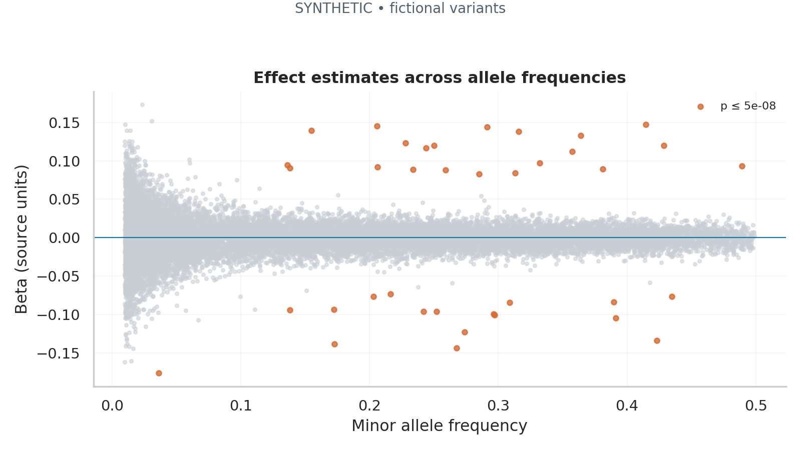
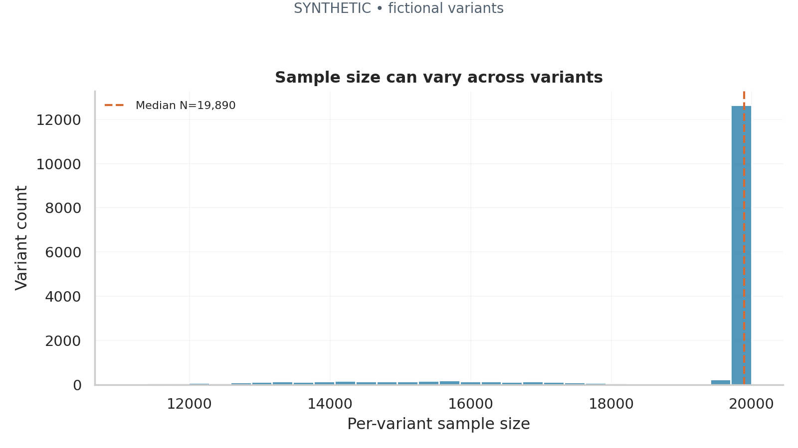
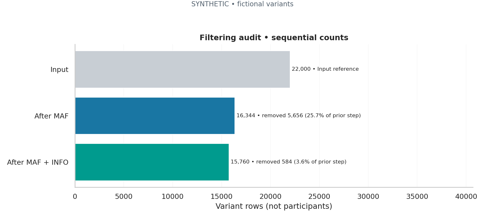
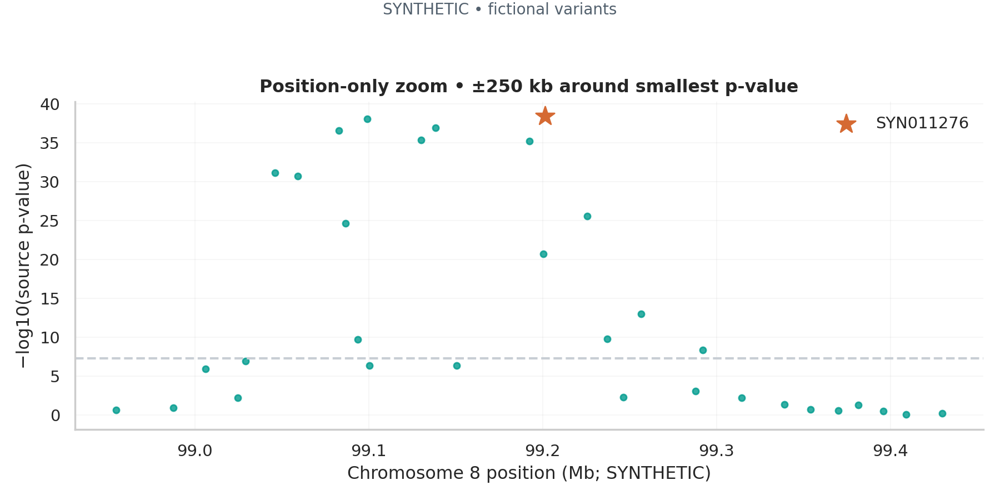
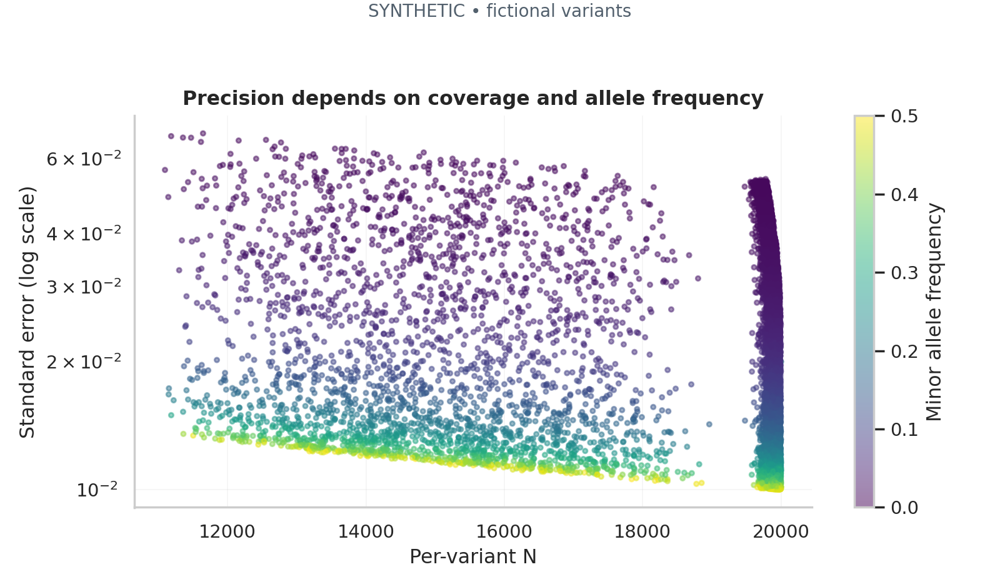
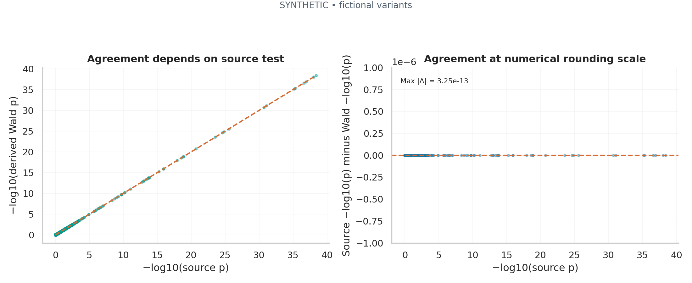

# Preview the results

All ten figures below come from the bundled synthetic inputs. Every figure is marked synthetic. Numerical values live in `results/synthetic/tables/`.

## Manhattan plot

**Question:** Where are the strongest associations?

{width=100%}

Each point is a retained variant. Autosomes alternate contrasting dark blue and orange; these colours distinguish chromosomes and do not encode effect direction or significance; the dashed line marks the configured reference p-value. Several nearby points do not establish several independent loci.

## Q–Q plot

**Question:** How do observed p-values compare with a simple null reference?

{width=100%}

Observed and expected −log10 p-values use all retained variants. The left panel shows the full tail and the right magnifies the central distribution using the same variants. The envelope is 95% pointwise under independent Uniform(0,1) p-values. Correlated variants and true signals limit this reference; it is neither simultaneous nor LD-adjusted.

## Effect estimates and intervals

**Question:** What direction and uncertainty do the smallest-p variants have?

{width=100%}

Row labels include variant ID, chromosome, position, and effect/other alleles. Beta is per copy of the named effect allele, relative to the other allele. Nearby variants may have opposite signs because their named alleles differ; sign comparisons require allele context. Intervals are unadjusted 95% Wald intervals for variants selected by p-value. They are subject to selection bias and are not independent-locus estimates.

## Frequency and imputation quality

**Question:** What measurements are being filtered?

{width=100%}

The panels show minor allele frequency and INFO distributions. Input and retained MAF histograms use identical bin edges. The low-frequency/common mixture is a teaching choice, not an empirical population estimate. Thresholds are teaching defaults, not universal quality rules. INFO definitions can vary by source pipeline.

## Effect versus frequency

**Question:** How do estimated effects vary across allele frequencies?

{width=100%}

Orange points meet the configured p-value reference. Low-frequency estimates can have different precision. This plot does not establish a biological relationship between frequency and effect.

## Per-variant sample size

**Question:** How much data supports each association?

{width=100%}

The synthetic distribution has most variants near nominal N=20,000 and a smaller lower-coverage tail. In real sources, variant-specific N can differ because of missingness or contributing cohorts. Counting variant rows does not count participants. Effective N and actual N must not be conflated when importing studies.

## Filtering audit

**Question:** How many variants remain after each step?

{width=100%}

Counts and percentages apply MAF first, then INFO. Percentages excluded at each step use the previous step as denominator. A variant failing both criteria is removed once. Invalid inputs stop the run; they are not silently discarded.

## Position-only association zoom

**Question:** What surrounds the smallest p-value?

{width=100%}

This plot uses ±250 kb around the retained variant with smallest p-value. It has no LD colours, gene tracks or fine-mapping probabilities. Synthetic positions have no biological mapping.

## Precision versus sample size

**Question:** why does higher N not guarantee that every variant has a smaller SE?

{width=100%}

SE depends jointly on N, frequency and INFO in this simulation. Colours provide frequency context; this scatter is not a fitted model or a causal test. The fixed reference row is an intentional exception to the simulated formula. Numerical evidence is in `precision-display.tsv`.

## Source versus derived Wald p-values

**Question:** do the supplied p-values agree with the beta/SE-derived normal test?

{width=100%}

Here, source p-values were generated by the same normal Wald formula, so near-perfect agreement is expected. The maximum difference in −log10(p) is about 3.3×10⁻¹³, consistent with numerical rounding. The difference panel retains a visible scale instead of magnifying that rounding into an apparent substantive discrepancy. These are arithmetic checks, not independent biological validation. Real source tests can differ legitimately; preserve their p-values and inspect the study methods.

**Your task:** choose one checked observation for each figure. Explain why a cluster of top variants does not identify independent loci, and why synthetic plots cannot establish a biological finding.

[Next: Meet the data](02-meet-the-data.qmd)
