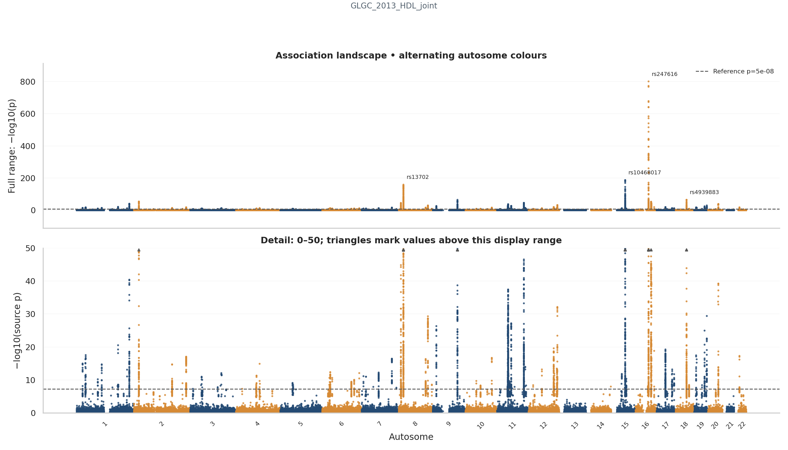
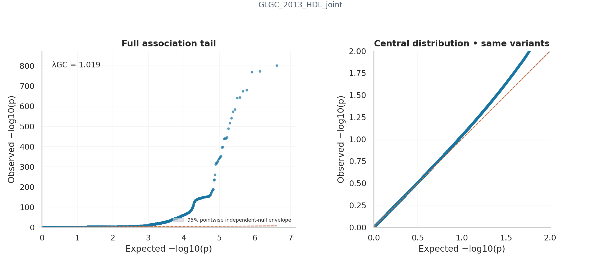
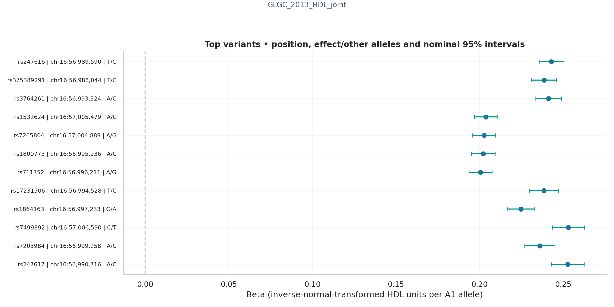
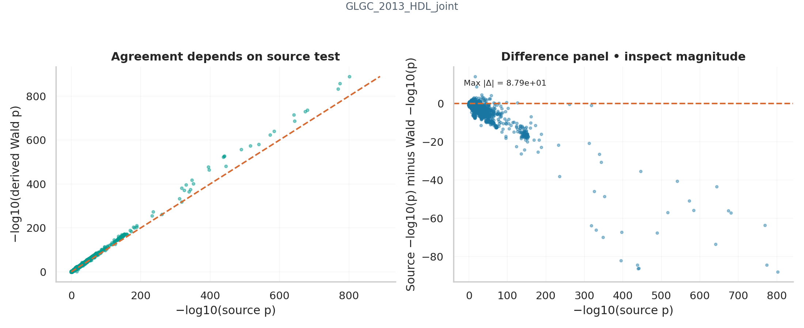
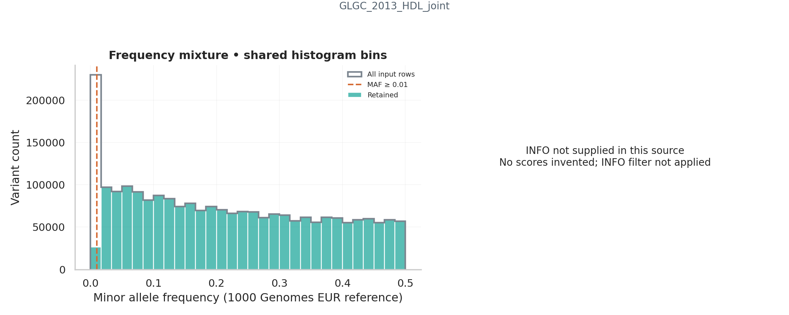

## Question and source

I inspected the joint GWAS/Metabochip HDL-cholesterol release from
Willer et al. (2013), doi:10.1038/ng.2797. Prepared coordinates use GRCh37.
The authors' source: https://csg.sph.umich.edu/willer/public/lipids2013/.
I examined association summaries, not participant-level genotypes.

## Preparation and methods

The source had 2,447,441 variant rows. Preparation excluded 186,081 with
unavailable reference frequency, leaving 2,261,360. Reference MAF ≥0.01
retained 2,058,079. Frequencies come from 1000 Genomes EUR, not the complete
study sample. INFO was unavailable and its filter was not applied.

Source p-values, including very small positive values, were preserved as
text. I inspected source associations and derived separate normal Wald
quantities from beta/SE. The source uses corrected meta-analysis results;
these need not equal the derived calculation. Beta units are transformed
HDL units per A1 allele, not mg/dL. A1 is coded as increasing HDL.

Dense scatter plots show all retained p≤1e-5 rows plus 50,000 other rows.
Summary counts and lambda use the full retained file. Q–Q expectations
use the full count; the pointwise band assumes an independent null.

## Verification

rs3764261 had A/C, beta 0.2412, SE 0.0039, z=61.8461538462,
source p=1.39e-769, source −log10(p)=768.8569852 and derived normal
Wald −log10(p)=832.466118689. Its derived nominal 95% interval was
0.2335561405–0.2488438595. Reference MAF was 0.2942.
[Record whether the independent verifier agreed with saved quantities.]

## Results

The smallest retained source p-value was 1.15e-802 for rs247616 on
chromosome 16 at 56,989,590. There were 3,285 retained variants at p≤5e-8.
This is not a count of independent loci.
[Add one checked observation from a different region.]

The tail departed strongly from the simple reference; lambda GC for the
retained source file was 1.018789. This release already used genomic control,
and the diagnostic does not prove absence of confounding.

[Describe allele coding, transformed units and the nearby positions.]

The source and derived tests differ. I retained the source p-values and
used the paper's meta-analysis methods to interpret the discrepancy.

[Describe the reference-frequency restriction and the unavailable quality field.]

## Limitations and next step

The analysis uses released summaries and a reference-frequency restriction.
It does not repeat the original participant QC, adjustment or meta-analysis.
Nominal intervals are derived from reported beta/SE and are unadjusted for
selecting top rows. No LD clumping, fine mapping, causal-gene assignment,
clinical-risk prediction or causal effect of HDL was established.
[Propose one next analysis with the additional inputs it would require.]

## Reproducibility

Inputs: data/glgc-hdl/. Outputs: results/glgc-hdl/.
Preparation: scripts/python/prepare_glgc.py.
Audit: data/provenance/glgc-hdl/preparation-audit.json.
Parameters, hashes and versions: results/glgc-hdl/tables/run-record.json.
[Record analysis date and code version.]
